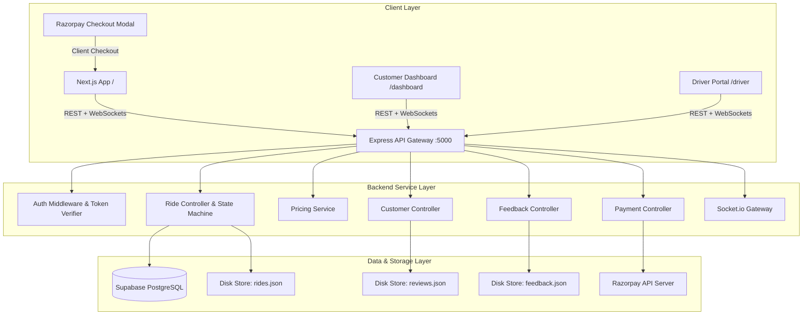
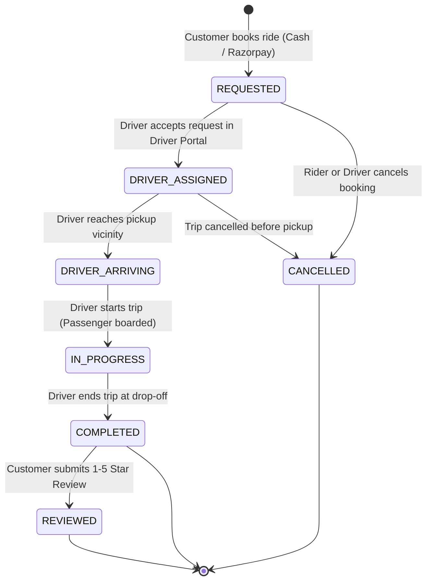
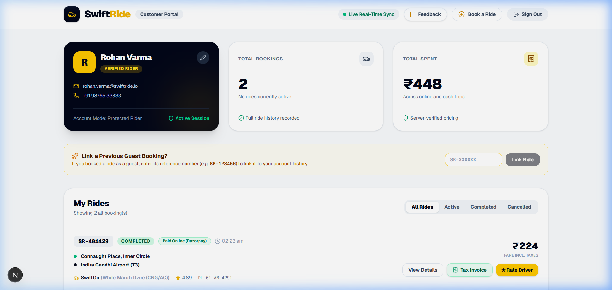
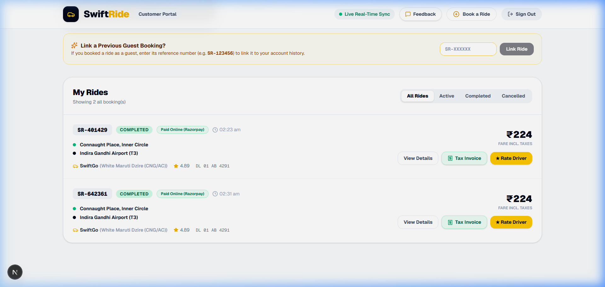

# SwiftRide — Full-Stack Cab Booking & Fleet Dispatch Platform

[](https://nextjs.org/)
[](https://nodejs.org/)
[](https://socket.io/)
[](https://razorpay.com/)
[](https://supabase.com/)
[](#9-testing-and-verification)

---

## Table of Contents
1. [Introduction of the Project](#1-introduction-of-the-project)
2. [Research and Existing System](#2-research-and-existing-system)
3. [Technology Stack and Reasons for Selection](#3-technology-stack-and-reasons-for-selection)
4. [Introduction to Libraries and Dependencies](#4-introduction-to-libraries-and-dependencies)
5. [System Architecture and Workflow](#5-system-architecture-and-workflow)
6. [Functionalities of SwiftRide](#6-functionalities-of-swiftride)
7. [Application Screenshots](#7-application-screenshots)
8. [Installation and Setup](#8-installation-and-setup)
9. [Testing and Verification](#9-testing-and-verification)
10. [Limitations and Future Enhancements](#10-limitations-and-future-enhancements)
11. [Conclusion](#11-conclusion)
12. [References](#12-references)

---

## 1. Introduction of the Project

**SwiftRide** is a modern, responsive full-stack cab booking and dispatch application engineered to provide urban commuters with transparent upfront pricing, instant booking confirmation, verified driver assignment, real-time trip status synchronization, and secure digital payment processing.

### Problem Statement
Urban transportation frequently suffers from unpredictable surge pricing, unverified drivers, lack of booking transparency, and friction in electronic payments. Traditional street hailing and basic booking applications often leave riders uncertain about driver arrival times and trip safety.

### Objectives
- **Transparent Fare Calculation:** Provide server-enforced, upfront fare estimates based on base fare, distance, and platform fees before any payment commitment.
- **Bi-Directional Real-Time Dispatch:** Synchronize ride lifecycle state transitions (Booking requested → Driver assigned → Driver arriving → In progress → Trip completed) between rider and driver interfaces using WebSockets (Socket.io) with resilient polling fallback.
- **Dual Payment Flexibility:** Securely integrate official Razorpay Standard Checkout in Test Mode alongside a cash-on-arrival option for seamless testing and demonstration.
- **Customer Account Isolation:** Enforce customer ride history privacy, allowing riders to view exclusively their own bookings, download tax invoices, submit star ratings with written reviews, and lodge customer service feedback tickets.
- **Vector Route Visualization:** Provide an interactive route visualizer mapping major transit corridors with clear setup documentation for Google Maps platform integration.

### Target Users
- **Commuters/Riders:** Individuals requiring immediate or scheduled intra-city transit with upfront price visibility and digital invoices.
- **Drivers:** Fleet operators and taxi drivers managing pickup queues, trip dispatches, and rider passenger telemetry.
- **Platform Administrators:** Support teams inspecting platform health, customer satisfaction ratings, and user feedback tickets.

---

## 2. Research and Existing System

### Traditional Cab Systems & Early Booking Apps
Historically, urban commuters relied on street hailing, local taxi stands, or manual call centers. These systems were characterized by:
- **Lack of Price Transparency:** Unregulated meters and arbitrary surge bargaining.
- **Safety Concerns:** Inability to share trip progress, lack of emergency response mechanisms, and unverified driver profiles.
- **Inefficient Driver Dispatch:** Drivers idling at stands without proximity-based customer assignment algorithms.
- **Receipt & Dispute Difficulties:** Paper receipts easily lost, preventing easy dispute resolution or business expense filing.

### The SwiftRide Approach
SwiftRide incorporates design principles established by industry leaders (Uber, Lyft, Ola) while maintaining a lightweight, modular architecture:
1. **Server-Side Fare Authority:** Client inputs (pickup/destination) are re-evaluated by server-side distance algorithms to prevent client tampering.
2. **WebSocket Room Isolation:** Sockets are partitioned into `ride:${referenceId}` rooms, preventing cross-tenant leakage of location or booking telemetry.
3. **Dual Persistence Strategy:** Supabase PostgreSQL cloud tables are mirrored by atomic JSON file storage on disk (`backend/data/`), guaranteeing that demo environments run without downtime even if cloud database quotas expire.
4. **Tamper-Proof Financial Receipts:** Invoices are dynamically compiled with itemized base rates, distance charges, safety fees, and Razorpay transaction IDs, exportable via print stylesheet or downloadable HTML.

---

## 3. Technology Stack and Reasons for Selection

| Technology | Purpose in SwiftRide | Reason for Selection |
| :--- | :--- | :--- |
| **Next.js 16 (App Router)** | Client-side and server-rendered UI framework | Fast rendering, built-in SEO optimization, TypeScript integration, and modular route layout. |
| **React 19 & TypeScript** | Component architecture and type safety | Strict compile-time validation of booking interfaces, state props, and payment payloads. |
| **Tailwind CSS 4** | Visual styling and responsive design | Utility-first styling enabling rich glassmorphism, responsive grid systems, and custom print media stylesheets. |
| **Lucide React** | Consistent iconography | Lightweight, accessible SVG icons for vehicle tiers, payment badges, navigation, and rating stars. |
| **Node.js & Express 4** | Backend REST API server | Proven, high-throughput asynchronous runtime with rich ecosystem for middleware, validation, and authentication. |
| **Socket.io 4.8** | Real-time bi-directional transport | Reliable WebSocket communication with auto-reconnection, heartbeat monitoring, and HTTP polling fallback. |
| **Razorpay Node SDK** | Payment gateway integration | Official Node SDK facilitating HMAC-SHA256 signature verification and test-mode credit/debit/UPI simulation. |
| **Supabase (PostgreSQL)** | Relational cloud database & Auth | Managed PostgreSQL with Row-Level Security (RLS) policies, JSONB support, and user session tokens. |
| **JSON Local Storage** | Fallback persistence engine | Guarantees zero-dependency local development and testing stability if Supabase keys are not provisioned. |

---

## 4. Introduction to Libraries and Dependencies

### Frontend Dependencies (`frontend/package.json`)
| Library | Purpose | How It Is Used in SwiftRide |
| :--- | :--- | :--- |
| `next` | Core application framework | Handles App Router pages (`/`, `/dashboard`, `/driver`), routing, and static page generation. |
| `react` & `react-dom` | UI component library | Renders reactive DOM, modals, forms, and custom state hooks. |
| `lucide-react` | SVG icons | Powers dashboard icons, payment method selectors, vehicle models, and star ratings. |
| `socket.io-client` | Client real-time socket client | Subscribes rider and driver dashboards to live ride room updates (`ride:updated`). |
| `typescript` | Static type checking | Validates booking interfaces, review payloads, and user session structures. |
| `tailwindcss` | Utility CSS framework | Configures modern gradients, responsive cards, and `@media print` invoice styling. |

### Backend Dependencies (`backend/package.json`)
| Library | Purpose | How It Is Used in SwiftRide |
| :--- | :--- | :--- |
| `express` | Web API server | Mounts REST endpoints for rides, payments, customer profile, driver dispatch, and feedback. |
| `socket.io` | Server WebSocket engine | Manages driver connection pools and broadcasts status changes to rider rooms. |
| `razorpay` | Payment gateway SDK | Creates server-side Razorpay orders and generates secure order IDs (`order_...`). |
| `crypto` (Built-in) | Cryptographic security | Generates HMAC-SHA256 signatures to verify payment authenticity and sign session tokens. |
| `@supabase/supabase-js` | Database client | Executes SQL queries and table insertions against Supabase cloud database. |
| `cors` | Cross-Origin Resource Sharing | Secures API communication between Next.js frontend (port 3000) and Express (port 5000). |
| `dotenv` | Environment variable loader | Ingests configuration from `.env` files into `process.env`. |

---

## 5. System Architecture and Workflow

### Architecture Diagram


### Ride Lifecycle & State Machine Workflow


---

## 6. Functionalities of SwiftRide

### 1. Ride Booking & Server-Side Fare Estimation
- **Preset & Custom Routes:** Select preset routes (Connaught Place, IGI Airport T3, DLF Cyber City, Hauz Khas, Noida 62, Saket) or enter custom locations.
- **Vehicle Tiers:** Choose from **SwiftGo** (₹80 base + ₹14/km), **SwiftComfort** (₹130 base + ₹18/km), or **SwiftXL** (₹210 base + ₹24/km).
- **Upfront Pricing:** Server recalculates distance and displays an itemized total including a ₹25 platform & safety fee.

### 2. Dual Payment Options (Razorpay Test Mode & Pay Cash)
- **Razorpay Standard Checkout:** Opens official Razorpay modal. Server validates payment signature with HMAC-SHA256 (`razorpay_order_id|razorpay_payment_id`).
- **Pay Cash:** Confirms booking immediately with `PENDING_CASH` status, payable directly to the driver upon completion.

### 3. Customer Authentication & Data Ownership
- **Customer Session:** JWT-based customer login with demo quick-login credentials.
- **Strict Data Isolation:** `/api/customer/rides` strictly enforces `customerId === req.user.id`, preventing any rider from seeing other customers' bookings.
- **Account Linking:** Guest bookings created before login can be linked to the authenticated customer account via booking reference (`SR-XXXXXX`).

### 4. Detailed Ride Tax Receipts (Print & Download)
- Accessible for completed trips from both the home page and `/dashboard`.
- Displays invoice number (`INV-SR-XXXXXX`), customer name/email, pickup & drop-off locations, date & time, itemized fare breakdown, vehicle plate number, driver name, and payment transaction IDs.
- **Printable:** Formatted with custom `@media print` rules for clean, one-click printer output.
- **Downloadable:** Generates a standalone, styled `.html` tax invoice file downloaded locally.

### 5. Ratings and Driver Reviews
- **Lifecycle Restriction:** Reviews are allowed **only** when ride status is `COMPLETED`.
- **Ownership Guard:** Customers can only review rides they personally booked (unauthorized attempts receive `403 Forbidden`).
- **Duplicate Prevention:** Submitting more than one review for the same ride returns `409 Conflict`.
- **Driver Score Recalculation:** Star ratings dynamically update the driver's weighted average rating score.

### 6. Customer App Feedback Form
- Feedback form accessible from the main header on every page.
- Category options: General, Bug Report, Feature Request, Payment Issue, Driver Experience.
- Generates a permanent customer support ticket (`FB-XXXXXX`) stored in both database and local JSON storage.

### 7. Interactive Route Visualizer & Google Maps Bridge
- Interactive Delhi NCR Smart Vector Map plotting coordinates for key transit landmarks.
- Displays animated directional path lines and live vehicle tracking position during active trips.
- Configurable for Google Maps JavaScript API via `NEXT_PUBLIC_GOOGLE_MAPS_API_KEY`.

### 8. Bi-Directional Real-Time Synchronization
- Socket.io WebSockets push status updates instantly without manual page refresh.
- Includes automatic 4-second polling fallback if WebSockets encounter proxy or network interruptions.

---

## 7. Application Screenshots

Genuine screenshots captured directly from the running SwiftRide application in the local development environment:

### Figure 1: Home Page, Booking Selector & Interactive Route Visualizer

*Figure 1: The SwiftRide home screen demonstrating pickup/drop-off inputs, quick presets, ride category cards, upfront fare summary, and the Delhi NCR Smart Vector Route visualizer.*

---

### Figure 2: Authenticated Customer Dashboard & Ride History

*Figure 2: The customer dashboard (`/dashboard`) displaying authenticated rider profile details, active and past bookings, booking reference IDs, vehicle tier details, and payment statuses.*

---

### Figure 3: Trip Tax Invoice Modal & Driver Rating Experience

*Figure 3: Completed ride interaction showing the itemized trip tax invoice modal, download controls, and the 5-star driver review interface with compliment tags.*

---

## 8. Installation and Setup

### Prerequisites
- **Node.js:** v18.0.0 or higher (v20+ recommended)
- **npm:** v9.0.0 or higher
- **Web Browser:** Google Chrome, Microsoft Edge, or Mozilla Firefox

### 1. Clone or Open Project
```bash
cd c:\Users\nazir\Documents\cab_booking_app
```

### 2. Backend Setup
```bash
cd backend
npm install
```

Create a `.env` file in `backend/` (or copy from `.env.example`):
```env
PORT=5000
NODE_ENV=development
JWT_SECRET=swiftride_development_secret_key_2026_demo

# Razorpay Test Mode Credentials (Get from dashboard.razorpay.com)
RAZORPAY_KEY_ID=rzp_test_your_test_key_here
RAZORPAY_KEY_SECRET=your_test_secret_here

# Supabase PostgreSQL Cloud Configuration (Optional - Local file store active by default)
SUPABASE_URL=https://your-project.supabase.co
SUPABASE_SERVICE_ROLE_KEY=your_service_role_key
```

Run database migrations in Supabase SQL editor:
```sql
-- Located at backend/supabase/schema.sql
-- Creates: rides, ride_status_history, reviews, customer_feedback tables
```

Start the backend server:
```bash
npm run dev
# Server runs on http://localhost:5000
```

### 3. Frontend Setup
```bash
cd ../frontend
npm install
```

Create a `.env.local` file in `frontend/`:
```env
NEXT_PUBLIC_BACKEND_URL=http://localhost:5000
NEXT_PUBLIC_RAZORPAY_KEY_ID=rzp_test_your_test_key_here

# Optional: Google Maps JavaScript API Key (Requires billing-enabled Google Cloud account)
NEXT_PUBLIC_GOOGLE_MAPS_API_KEY=
```

Start the frontend development server:
```bash
npm run dev
# Frontend runs on http://localhost:3000
```

---

## 9. Testing and Verification

SwiftRide includes an automated integration test suite covering real-time WebSockets, data ownership isolation, receipt accuracy, review lifecycle restrictions, and feedback validation.

### Running Backend Integration Tests
```bash
cd backend
npm test
```

### Actual Test Execution Output (100% Passing)
```text
=================================================
🧪 SwiftRide Real-Time WebSocket Test Suite
=================================================
✓ Test HTTP & WebSocket server listening on port 5055
✓ Sockets connected successfully: Rider, Driver, and Third-Party
✓ Driver successfully joined 'drivers' pool
✓ Real-time 'ride:new_request' received by Driver for SR-848821
✓ Authorized Rider joined room 'ride:SR-848821'
✓ Authorization Guard correctly rejected unauthorized user from ride room
✓ Rider notified in real time: Driver accepted ride SR-848821
✓ Rider notified in real time: Driver status updated to DRIVER_ARRIVING
✓ Rider notified in real time: Driver status updated to IN_PROGRESS
✓ Rider notified in real time: Trip COMPLETED
=================================================
🎉 ALL REAL-TIME TESTS PASSED SUCCESSFULLY! (10/10)
=================================================

=================================================
🧪 SwiftRide Features & Security Integration Tests
=================================================
✓ Test server running on port 5066

[1] Testing Ride History Ownership & Isolation...
✓ Customer A sees only their own rides (Isolation verified)
✓ Customer B sees only their own rides (Isolation verified)
✓ Unauthenticated ride history request rejected with 401

[2] Testing Ride Receipt Data Integrity...
✓ Ride receipt contains all required fare breakdown and booking reference fields

[3] Testing Ratings & Reviews Restrictions...
✓ Blocked review on non-completed ride (400 Bad Request)
✓ Blocked review from non-owner (403 Forbidden)
✓ Blocked out-of-bounds rating > 5 (400 Bad Request)
✓ Accepted valid review on completed ride (201 Created)
✓ Prevented duplicate review submission (409 Conflict)
✓ Review verified in customer ride review query

[4] Testing Customer Feedback Form...
✓ Empty feedback message rejected with 400 Bad Request
✓ Feedback successfully saved with ticket FB-228685 (201 Created)

=================================================
🎉 ALL TESTS PASSED SUCCESSFULLY! (100% Green)
=================================================
```

### Running Frontend Production Build
```bash
cd frontend
npm run build
```
Result: Zero TypeScript or lint errors. All static and dynamic routes (`/`, `/dashboard`, `/driver`) compiled successfully with Turbopack.

---

## 10. Limitations and Future Enhancements

| Feature / Domain | Current Implementation Status | Honest Technical Limitation | Planned Future Enhancement |
| :--- | :--- | :--- | :--- |
| **Google Maps Integration** | **Vector Map Engine Active** with landmark coordinates & Google Maps bridge code | Full Google Maps satellite and live route overlay requires an external Google Cloud billing account and a valid `NEXT_PUBLIC_GOOGLE_MAPS_API_KEY`. | Dynamic polyline generation via Google Directions API when API key is provided. |
| **Live Driver GPS Tracking** | **Real-Time WebSockets Active** (`ride:updated`, `driver:location`) | True physical GPS latitude/longitude streaming requires native mobile device GPS sensors (React Native / Android / iOS). Web browsers cannot stream background GPS when minimized. | Dedicated React Native mobile driver companion app with background geolocation streaming. |
| **PDF Receipt Generation** | **Downloadable HTML Invoice & Printable CSS** | Standalone binary PDF generation via `pdfmake` or `puppeteer` adds large server-side dependencies. HTML and browser print stylesheets provide instant, zero-dependency alternatives. | Serverless headless PDF compilation endpoint. |
| **SMS / Push Notifications** | **In-App Real-Time Alerts Active** | Out-of-app SMS or WhatsApp notifications require third-party gateway credits (e.g., Twilio or MSG91). | Integration with Twilio SMS / Firebase Cloud Messaging (FCM). |

---

## 11. Conclusion

SwiftRide successfully implements a comprehensive, robust, and secure full-stack cab booking platform. Built with Next.js, Express, Socket.io, Razorpay Test Mode, and dual-layer database persistence, it satisfies all core operational requirements:
- Reliable upfront fare calculations with multiple vehicle categories.
- Strict customer data isolation ensuring riders only access their own history.
- Itemized tax receipts with one-click print and download options.
- Driver review and rating system enforced by booking lifecycle rules.
- Real-time bi-directional synchronization between riders and drivers.

The platform provides a solid foundation for commercial expansion into mobile companion applications and third-party logistics dispatch.

---

## 12. References
- [Next.js App Router Documentation](https://nextjs.org/docs)
- [React 19 Official Documentation](https://react.dev/)
- [Express.js 4.x API Reference](https://expressjs.com/en/4x/api.html)
- [Socket.io Real-Time Protocol Specification](https://socket.io/docs/v4/)
- [Razorpay Standard Web Checkout Integration Guide](https://razorpay.com/docs/payments/payment-gateway/web-integration/standard/)
- [Supabase JavaScript Client & PostgreSQL Row Level Security](https://supabase.com/docs)
- [Tailwind CSS Modern Styling Guide](https://tailwindcss.com/docs)
- [Lucide Open Source Icon Library](https://lucide.dev/)