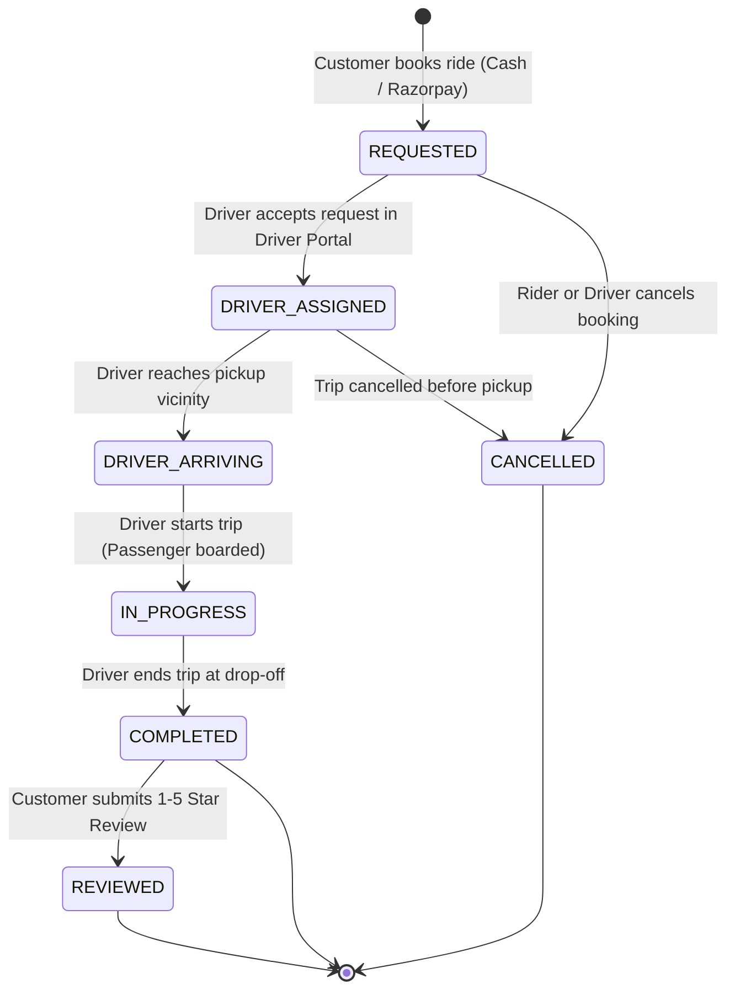
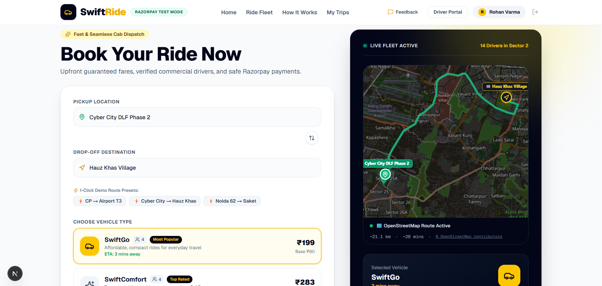

# SwiftRide — Full-Stack Cab Booking & Fleet Dispatch Platform

[](https://nextjs.org/)
[](https://nodejs.org/)
[](https://leafletjs.com/)
[](https://socket.io/)
[](https://razorpay.com/)
[](https://supabase.com/)
[](#9-testing-and-verification)

---

## Table of Contents
1. [1. Introduction of the Project](#1-introduction-of-the-project)
2. [2. Research and Existing System](#2-research-and-existing-system)
3. [3. Technology Stack and Reasons for Selection](#3-technology-stack-and-reasons-for-selection)
4. [4. Introduction to Libraries and Dependencies](#4-introduction-to-libraries-and-dependencies)
5. [5. System Architecture and Workflow](#5-system-architecture-and-workflow)
6. [6. Functionalities of SwiftRide](#6-functionalities-of-swiftride)
7. [7. Application Screenshots](#7-application-screenshots)
8. [8. Installation and Setup](#8-installation-and-setup)
9. [9. Testing and Verification](#9-testing-and-verification)
10. [10. Limitations and Future Enhancements](#10-limitations-and-future-enhancements)
11. [11. Conclusion](#11-conclusion)
12. [12. References](#12-references)

---

## 1. Introduction of the Project

**SwiftRide** is a modern, responsive full-stack cab booking and dispatch application engineered to provide urban commuters with transparent upfront pricing, instant booking confirmation, verified driver assignment, real-time trip status synchronization, interactive road maps, and secure digital payment processing.

### Problem Statement
Urban transportation frequently suffers from unpredictable surge pricing, unverified drivers, lack of booking transparency, and friction in electronic payments. Traditional street hailing and basic booking applications often leave riders uncertain about driver arrival times, actual route paths, and trip safety.

### Objectives
- **Transparent Fare Calculation:** Provide server-enforced, upfront fare estimates based on base fare, distance rates, and platform fees before any payment commitment.
- **Bi-Directional Real-Time Dispatch:** Synchronize ride lifecycle state transitions (Booking requested → Driver assigned → Driver arriving → In progress → Trip completed) between rider and driver interfaces using WebSockets (Socket.io) with resilient polling fallback.
- **Dual Payment Flexibility:** Securely integrate official Razorpay Standard Checkout in Test Mode alongside a cash-on-arrival option for seamless testing and demonstration.
- **Customer Account Isolation:** Enforce customer ride history privacy, allowing riders to view exclusively their own bookings, download itemized tax invoices, submit star ratings with written reviews, and lodge customer feedback tickets.
- **Keyless Open-Source Mapping:** Deliver an interactive, responsive map powered by **Leaflet.js**, official **OpenStreetMap (OSM)** tiles, and the free public **OSRM (Open Source Routing Machine)** engine, avoiding reliance on paid third-party map keys.

### Target Users
- **Commuters/Riders:** Individuals requiring immediate or scheduled intra-city transit with upfront price visibility, live route tracking, and digital invoices.
- **Drivers:** Fleet operators and taxi drivers managing pickup queues, accepting dispatch requests, updating ride status in real time, and tracking earnings.

---

## 2. Research and Existing System

### Traditional Cab Systems & Early Booking Apps
Historically, urban commuters relied on street hailing, local taxi stands, or manual call centers. These systems were characterized by:
- **Lack of Price Transparency:** Unregulated meters and arbitrary surge bargaining.
- **Safety Concerns:** Inability to share trip progress, lack of digital receipts, and unverified driver profiles.
- **Inefficient Driver Dispatch:** Drivers idling at stands without proximity-based customer assignment queues.
- **Receipt & Dispute Difficulties:** Paper receipts easily lost, preventing straightforward dispute resolution or corporate expense filing.

### The SwiftRide Approach
SwiftRide incorporates design principles established by modern mobility platforms while maintaining a lightweight, modular architecture:
1. **Server-Side Fare Authority:** Client inputs (pickup/destination) are evaluated by server-side distance algorithms to prevent client tampering.
2. **WebSocket Room Isolation:** Sockets are partitioned into `ride:${referenceId}` rooms, preventing cross-tenant leakage of location or booking telemetry.
3. **Resilient Local-First Persistence:** Primary data persistence operates directly on local atomic JSON file stores in `backend/data/` (`rides.json`, `users.json`, `drivers.json`, `feedback.json`, `reviews.json`), with optional Supabase PostgreSQL connectivity if cloud credentials are provided.
4. **Tamper-Proof Financial Receipts:** Invoices are dynamically compiled with itemized base rates, distance charges, safety fees, and Razorpay transaction IDs, exportable via print stylesheet or downloadable HTML.
5. **Open Mapping Ecosystem:** Utilizes Leaflet.js and OpenStreetMap data to plot high-DPI pins, animate vehicle locations, and calculate road paths without proprietary map billing dependencies.

---

## 3. Technology Stack and Reasons for Selection

| Technology | Purpose in SwiftRide | Reason for Selection |
| :--- | :--- | :--- |
| **Next.js 16 (App Router)** | Client-side and server-rendered UI framework | Fast rendering, built-in SEO optimization, TypeScript integration, and modular route layout (`/`, `/book-ride`, `/dashboard`, `/driver`). |
| **React 19 & TypeScript 5** | Component architecture and type safety | Strict compile-time validation of booking interfaces, state props, and payment payloads. |
| **Tailwind CSS 4** | Visual styling and responsive design | Utility-first styling enabling rich glassmorphism, responsive grid layouts, and custom `@media print` invoice styling. |
| **Leaflet.js 1.9** | Interactive mapping engine | Lightweight, mobile-friendly open-source mapping library integrated without paid API keys. |
| **OpenStreetMap & OSRM** | Map tiles & road routing service | Community-driven global map tiles and open-source road routing with zero per-request licensing costs. |
| **Lucide React** | Consistent iconography | Lightweight, accessible SVG icons for vehicle tiers, payment badges, navigation, and rating stars. |
| **Node.js & Express 4** | Backend REST API server | High-throughput asynchronous runtime with rich ecosystem for middleware, validation, and authentication. |
| **Socket.io 4.8** | Real-time bi-directional transport | Reliable WebSocket communication with room-based pub/sub, heartbeat monitoring, and HTTP polling fallback. |
| **Razorpay Node SDK** | Payment gateway integration | Official Node SDK facilitating HMAC-SHA256 signature verification and test-mode payment order creation. |
| **JSON Local Storage** | Primary persistence engine | Guarantees zero-dependency local development and testing stability out of the box (`backend/data/`). |
| **Supabase (PostgreSQL)** | Optional cloud database | Optional cloud PostgreSQL database adapter when cloud credentials (`SUPABASE_URL` / keys) are supplied. |

---

## 4. Introduction to Libraries and Dependencies

### Frontend Dependencies (`frontend/package.json`)
| Library | Version | Purpose | How It Is Used in SwiftRide |
| :--- | :--- | :--- | :--- |
| `next` | `16.4.0` | Core application framework | Handles App Router pages (`/`, `/book-ride`, `/dashboard`, `/driver`), routing, and Turbopack builds. |
| `react` & `react-dom` | `19.3.0` | UI component library | Renders reactive DOM, modals, forms, and custom state hooks. |
| `leaflet` | `^1.9.4` | Map rendering engine | Powers the interactive Delhi NCR route map in [`RouteMap.tsx`](frontend/app/components/RouteMap.tsx). |
| `@types/leaflet` | `^1.9.22` | Leaflet type definitions | TypeScript validation for Leaflet map instances, markers, and bounds. |
| `lucide-react` | `^1.55.0` | SVG icons | Powers dashboard icons, payment badges, vehicle models, and star ratings. |
| `socket.io-client` | `^4.8.4` | Real-time WebSocket client | Subscribes rider and driver dashboards to live ride room updates (`ride:updated`). |
| `typescript` | `^5` | Static type checking | Validates booking interfaces, review payloads, and user session structures. |
| `tailwindcss` | `^4` | Utility CSS framework | Configures modern gradients, responsive cards, and dark mode styles. |

### Backend Dependencies (`backend/package.json`)
| Library | Version | Purpose | How It Is Used in SwiftRide |
| :--- | :--- | :--- | :--- |
| `express` | `^4.21.2` | Web API server | Mounts REST endpoints for rides, payments, customer profile, driver dispatch, and feedback. |
| `socket.io` | `^4.8.4` | Server WebSocket engine | Manages driver connection pools and broadcasts status changes to rider rooms. |
| `razorpay` | `^2.9.5` | Payment gateway SDK | Creates server-side Razorpay orders and generates secure order IDs (`order_...`). |
| `crypto` (Built-in) | Native | Cryptographic security | Generates HMAC-SHA256 signatures for payments and signs custom JWT session tokens. |
| `@supabase/supabase-js` | `^2.117.3` | Database client | Optional PostgreSQL client querying Supabase tables when cloud credentials are provided. |
| `cors` | `^2.8.5` | CORS middleware | Configures allowed origins between Next.js frontend (port 3000) and Express (port 5000). |
| `dotenv` | `^16.4.7` | Environment variable loader | Ingests configuration from `backend/.env` into `process.env`. |

---

## 5. System Architecture and Workflow

### Architecture Diagram

flowchart TD
    subgraph Client["Client Layer - Next.js"]
        UI["SwiftRide Frontend"]
        MAP["Leaflet Map - OpenStreetMap"]
    end

    subgraph Server["Backend Layer - Node.js"]
        API["Express REST API"]
        AUTH["JWT Authentication"]
        RIDE["Ride Management"]
        PAY["Razorpay Test Payments"]
    end

    subgraph Data["Data Layer"]
        DB[("Supabase PostgreSQL")]
        JSON["JSON File Fallback"]
    end

    UI --> API
    MAP --> UI
    API --> AUTH
    API --> RIDE
    API --> PAY
    RIDE --> DB
    RIDE --> JSON
```

### Ride Lifecycle & State Machine Workflow


---

## 6. Functionalities of SwiftRide

### 1. Landing Page & Dedicated Booking Flow
- **Modern Landing Page (`/`):** Features an engaging hero section, quick vehicle tier showcase, "How It Works" visual progression, feature highlights, customer testimonials, and direct "Book a Ride" CTA navigation.
- **Dedicated Booking Page (`/book-ride`):** Clean, focused ride configuration interface with pickup and drop-off inputs, 1-click popular Delhi NCR presets (Connaught Place, IGI Airport T3, DLF Cyber City, Hauz Khas, Noida 62, Saket), live fare calculations, payment method selection, and interactive route visualization.

### 2. Upfront Server-Enforced Fare Pricing
- **Vehicle Tiers:**
  - **SwiftGo:** ₹80 base fare + ₹14/km (Seats 4, compact everyday travel).
  - **SwiftComfort:** ₹130 base fare + ₹18/km (Seats 4, sedans with top-rated drivers).
  - **SwiftXL:** ₹210 base fare + ₹24/km (Seats 6, spacious SUVs for groups and luggage).
- **Pricing Service:** Fares are validated and recalculated on the server ([`backend/src/services/pricingService.js`](backend/src/services/pricingService.js)) incorporating a ₹25 platform & safety fee. Client-side numbers cannot be tampered with.

### 3. Dual Payment Options (Razorpay Test Mode & Pay Cash)
- **Razorpay Standard Checkout:** Dynamically requests order creation from `POST /api/payments/create-order` and validates payment authenticity using HMAC-SHA256 (`razorpay_order_id|razorpay_payment_id`). Verified online payments are persisted as `paymentMethod: "razorpay"` and `paymentStatus: "paid"`.
- **Pay Cash:** Confirms booking immediately with `paymentMethod: "cash"` and `paymentStatus: "pending_cash"`, payable directly to the driver upon trip arrival.

### 4. Customer Authentication & Strict Data Isolation
- **HMAC-SHA256 JWT Authentication:** Implemented natively in [`backend/src/utils/token.js`](backend/src/utils/token.js) with password hashing via `crypto.scryptSync`. Generates tamper-proof 7-day session tokens.
- **Strict Data Isolation:** `/api/customer/rides` filters bookings strictly matching `customerId === req.user.id`. Riders cannot query or inspect other users' bookings.
- **Guest Booking Linking:** Unauthenticated bookings can be linked to a logged-in account via the booking reference (`SR-XXXXXX`).

### 5. Interactive Leaflet.js & OpenStreetMap Route Visualizer
- **Keyless Open-Source Mapping:** Uses **Leaflet.js** and official **OpenStreetMap (OSM)** tiles without requiring paid API keys from Google Maps or Mapbox.
- **Real Road Paths via OSRM:** Fetches actual road geometries from the free public OSRM demo API with smooth mathematical curve fallbacks.
- **High-DPI Custom Markers:** Renders custom HTML markers for Pickup (emerald badge), Drop-off (amber badge), and live vehicle position (car badge).
- **Live Driver Telemetry:** Vehicle marker smoothly animates along the active route when ride status is `DRIVER_ASSIGNED`, `DRIVER_ARRIVING`, or `IN_PROGRESS`.
- **Theme Options:** Includes Day view (standard OSM tiles) and Night Mode (pure CSS inversion filter on OSM tiles) with full map controls (Zoom In, Zoom Out, Fit Bounds).

### 6. Driver Dispatch Portal (`/driver`)
- Allows drivers to join the real-time active driver pool, inspect incoming trip requests, accept bookings, and advance the ride state machine:
  - `DRIVER_ASSIGNED` → `DRIVER_ARRIVING` → `IN_PROGRESS` → `COMPLETED`.
- Displays real-time driver metrics: Total trips completed, acceptance rates, and current rating scores.

### 7. Customer Dashboard, Invoices & Reviews (`/dashboard`)
- **Ride History:** Tabbed view filtering bookings by status (`ALL`, `ACTIVE`, `COMPLETED`, `CANCELLED`).
- **Itemized Tax Invoices:** Accessible for completed rides with detailed fare breakdowns, vehicle plate numbers, booking references, and transaction IDs. Includes print-ready CSS (`@media print`) and downloadable standalone `.html` invoices.
- **Driver Ratings & Reviews:** Authenticated customers can submit a 1–5 star rating and written review once a ride reaches `COMPLETED` status. Prevents reviews on incomplete rides, unauthorized cross-user reviews, and duplicate review submissions.
- **Feedback Form:** Embedded support modal allowing riders to submit general inquiries, bug reports, payment issues, or driver feedback, issuing unique ticket IDs (`FB-XXXXXX`).

---

## 7. Application Screenshots

Genuine screenshots captured directly from the running SwiftRide application in the local development environment:

### Figure 1: Ride Booking Page & Interactive Leaflet Route Visualizer

*Figure 1: The SwiftRide booking screen (`/book-ride`) demonstrating pickup/drop-off inputs, quick presets, ride category cards, upfront fare summary, and the Leaflet OpenStreetMap route visualizer.*

---

### Figure 2: Authenticated Customer Dashboard & Ride History

*Figure 2: The customer dashboard (`/dashboard`) displaying authenticated rider profile details, active and past bookings, booking reference IDs, vehicle tier details, and payment statuses.*

---

### Figure 3: Trip Tax Invoice Modal & Driver Rating Experience

*Figure 3: Completed ride interaction showing the itemized trip tax invoice modal, download controls, and the 5-star driver review interface with compliment tags.*

---

## 8. Installation and Setup

### Prerequisites
- **Node.js:** v18.0.0 or higher (v20+ recommended)
- **npm:** v9.0.0 or higher
- **Operating System:** Windows, macOS, or Linux
- **Web Browser:** Modern browser (Chrome, Edge, Firefox, Safari)

### 1. Clone or Open the Repository
In Windows PowerShell or terminal:
```powershell
cd c:\Users\nazir\Documents\cab_booking_app
```

---

### 2. Backend Setup
Open a terminal for the backend:
```powershell
cd c:\Users\nazir\Documents\cab_booking_app\backend
npm install
```

Create a `.env` file in `backend/` (or copy from [`.env.example`](backend/.env.example)):
```powershell
Copy-Item .env.example .env
```

Configure your environment variables in `backend/.env`:
```env
# Server Configuration
PORT=5000
NODE_ENV=development
CLIENT_URL=http://localhost:3000

# JWT Authentication Secret
JWT_SECRET=your_secure_random_jwt_secret_here

# Razorpay Test Mode Credentials (Required only for online test checkout)
# Get test keys from: https://dashboard.razorpay.com/app/keys
RAZORPAY_KEY_ID=rzp_test_yourKeyHere
RAZORPAY_KEY_SECRET=yourSecretKeyHere

# Optional: Supabase PostgreSQL Cloud Configuration
# If omitted, SwiftRide automatically uses local JSON storage in backend/data/
SUPABASE_URL=https://your-project-id.supabase.co
SUPABASE_SERVICE_ROLE_KEY=yourServiceRoleKeyHere
SUPABASE_ANON_KEY=yourAnonKeyHere
```

Start the backend development server:
```powershell
npm run dev
# Backend API and WebSockets listen on http://localhost:5000
```

---

### 3. Frontend Setup
Open a second terminal for the frontend:
```powershell
cd c:\Users\nazir\Documents\cab_booking_app\frontend
npm install
```

Create a `.env.local` file in `frontend/`:
```env
NEXT_PUBLIC_BACKEND_URL=http://localhost:5000
NEXT_PUBLIC_RAZORPAY_KEY_ID=rzp_test_yourKeyHere
```
*(Note: Map rendering uses Leaflet.js and OpenStreetMap and requires no map API keys).*

Start the frontend development server:
```powershell
npm run dev
# Frontend web application opens on http://localhost:3000
```

---

## 9. Testing and Verification

SwiftRide includes an automated integration test suite covering real-time WebSockets, data ownership isolation, receipt accuracy, review lifecycle restrictions, customer feedback validation, and Razorpay HMAC payment signature verification.

### Running Backend Integration Tests
In PowerShell or terminal:
```powershell
cd c:\Users\nazir\Documents\cab_booking_app\backend
npm test
```

### Actual Verified Test Execution Output (100% Passing)
```text
> swiftride-backend@1.0.0 test
> node tests/realtime.test.js && node tests/features.test.js

=================================================
🧪 SwiftRide Real-Time WebSocket Test Suite
=================================================
✓ Test HTTP & WebSocket server listening on port 5055
✓ Sockets connected successfully: Rider, Driver, and Third-Party
✓ Driver successfully joined 'drivers' pool
✓ Real-time 'ride:new_request' received by Driver for SR-233059
✓ Authorized Rider joined room 'ride:SR-233059'
✓ Authorization Guard correctly rejected unauthorized user from ride room
✓ Rider notified in real time: Driver accepted ride SR-233059
✓ Rider notified in real time: Driver status updated to DRIVER_ARRIVING
✓ Rider notified in real time: Driver status updated to IN_PROGRESS
✓ Rider notified in real time: Trip COMPLETED
=================================================
🎉 ALL REAL-TIME TESTS PASSED SUCCESSFULLY! (10/10)
=================================================
✓ Test server closed cleanly.

=================================================
🧪 SwiftRide Features & Security Integration Tests
=================================================
✓ Test server running on port 5066

[1] Testing Ride History Ownership & Isolation...
✓ Customer A sees only their own rides (Isolation verified)
✓ Customer B sees only their own rides (Isolation verified)
✓ Unauthenticated ride history request rejected with 401

[2] Testing Ride Receipt Data Integrity...
✓ Ride receipt contains all required fare breakdown and booking reference fields

[3] Testing Ratings & Reviews Restrictions...
[ClientError 400] Reviews can only be submitted for completed trips.
✓ Blocked review on non-completed ride (400 Bad Request)
[ClientError 403] You are not authorized to review this ride. You can only review rides that you booked.
✓ Blocked review from non-owner (403 Forbidden)
[ClientError 400] Rating must be an integer between 1 and 5.
✓ Blocked out-of-bounds rating > 5 (400 Bad Request)
✓ Accepted valid review on completed ride (201 Created)
[ClientError 409] A review has already been submitted for this ride booking.
✓ Prevented duplicate review submission (409 Conflict)
✓ Review verified in customer ride review query

[4] Testing Customer Feedback Form...
[ClientError 400] Invalid feedback category. Allowed categories: GENERAL, BUG_REPORT, FEATURE_REQUEST, PAYMENT, DRIVER_EXPERIENCE.
✓ Empty feedback message rejected with 400 Bad Request
✓ Feedback successfully saved with ticket FB-625236 (201 Created)

[5] Testing Razorpay Payment Verification & Persistence...
✓ Razorpay order created with pending status and razorpay method
✓ Tampered/invalid payment signature rejected (400) without modifying ride status
✓ Server-side HMAC verified; booking record correctly persisted with paymentMethod: 'razorpay' and paymentStatus: 'paid'
✓ Existing ride SR-618545 reconciled with verified payment record

=================================================
🎉 ALL TESTS PASSED SUCCESSFULLY! (100% Green)
=================================================
✓ Test server closed safely
```

### Running Frontend Production Build
To verify type safety and static prerendering:
```powershell
cd c:\Users\nazir\Documents\cab_booking_app\frontend
npm run build
```
Result: Zero TypeScript or lint errors. All routes (`/`, `/book-ride`, `/dashboard`, `/driver`) compiled successfully with Turbopack.

---

## 10. Limitations and Future Enhancements

| Feature / Domain | Current Implementation Status | Honest Technical Limitation | Planned Future Enhancement |
| :--- | :--- | :--- | :--- |
| **Mapping & Routing** | **Leaflet.js + OpenStreetMap Active** with OSRM routing | Public demo OSRM endpoint has occasional rate limiting during peak hours (handled via built-in geometric fallback). | Self-hosted OSRM Docker routing instance or cached tile vector server. |
| **Live Driver GPS Tracking** | **Real-Time WebSockets Active** (`ride:updated`) | True physical GPS latitude/longitude streaming requires native mobile device GPS hardware. Web browsers cannot stream background GPS when minimized or asleep. | Dedicated React Native / Flutter driver companion app with background geolocation streaming. |
| **PDF Receipt Generation** | **Downloadable HTML Invoice & Printable CSS** | Standalone binary PDF compilation via `pdfmake` or `puppeteer` adds large server-side headless browser dependencies. Styled HTML and browser print stylesheets provide instant, zero-dependency alternatives. | Serverless headless PDF compilation endpoint. |
| **SMS / Push Notifications** | **In-App Real-Time Alerts Active** | Out-of-app SMS or WhatsApp notifications require paid third-party gateway credits (e.g., Twilio or MSG91). | Integration with Twilio SMS / Firebase Cloud Messaging (FCM). |
| **Database Storage** | **Local JSON Files with Supabase Fallback** | Local JSON storage is single-instance and file-locked; multi-instance deployment requires configuring a persistent PostgreSQL instance. | Production migration to Supabase PostgreSQL with automated database schema migrations. |

---

## 11. Conclusion

SwiftRide provides a dependable, transparent, and secure full-stack cab booking platform. Built with Next.js 16, Express, Socket.io, Leaflet.js with OpenStreetMap, Razorpay Test Mode, and resilient local-first persistence, it addresses all primary commuter and fleet dispatch requirements:
- Reliable upfront fare calculations across three distinct vehicle categories.
- Keyless, interactive route visualizer rendering road paths with live driver movement.
- Strict customer data isolation ensuring riders only access their own trip history.
- Itemized tax receipts with one-click print and HTML download capabilities.
- Driver review and rating system enforced by booking lifecycle rules.
- Real-time bi-directional status updates between riders and drivers without manual page refresh.

The architecture provides a clean, maintainable foundation for local demonstration, academic evaluation, or production scaling into mobile companion applications.

---

## 12. References
- [Next.js App Router Documentation](https://nextjs.org/docs)
- [React 19 Official Documentation](https://react.dev/)
- [Leaflet.js Official Documentation](https://leafletjs.com/reference.html)
- [OpenStreetMap Tile Usage Policy](https://operations.osmfoundation.org/policies/tiles/)
- [OSRM (Open Source Routing Machine) API Documentation](https://project-osrm.org/docs/v5.24.0/api/)
- [Express.js 4.x API Reference](https://expressjs.com/en/4x/api.html)
- [Socket.io Real-Time Protocol Specification](https://socket.io/docs/v4/)
- [Razorpay Standard Web Checkout Integration Guide](https://razorpay.com/docs/payments/payment-gateway/web-integration/standard/)
- [Supabase JavaScript Client Documentation](https://supabase.com/docs)
- [Tailwind CSS Modern Styling Guide](https://tailwindcss.com/docs)
- [Lucide Open Source Icon Library](https://lucide.dev/)